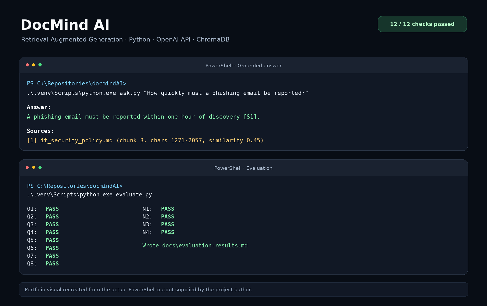
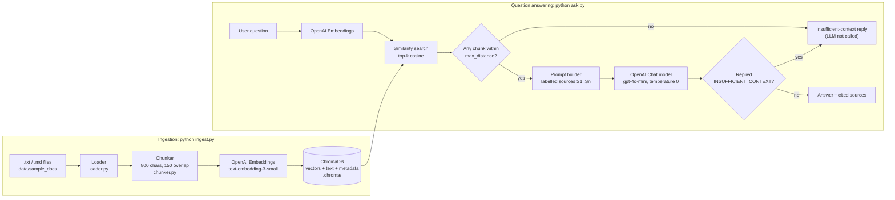
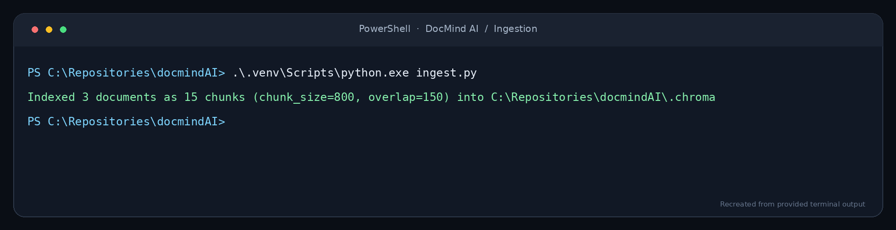
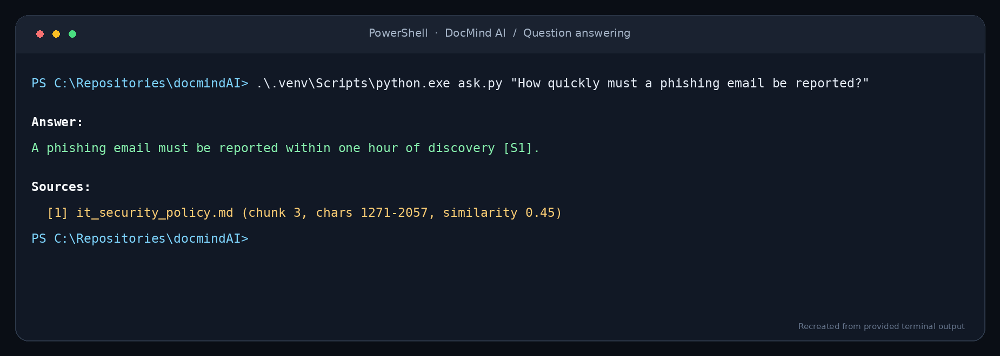
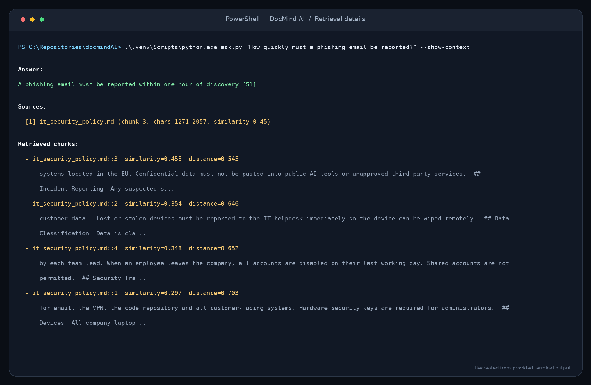
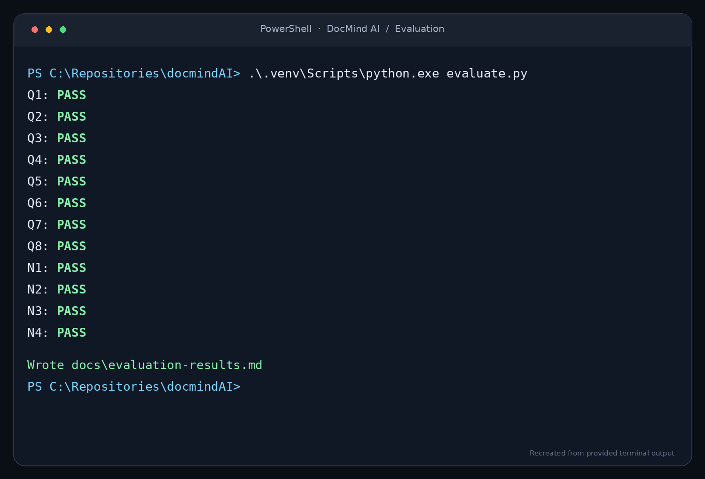

# DocMind AI

**A minimal Retrieval-Augmented Generation (RAG) proof of concept: answer questions about your own documents and show which passages each answer came from.**

Python · OpenAI embeddings · ChromaDB · OpenAI chat model · pytest



*Image recreated from real PowerShell output of this project. Raw outputs are in [Demonstration questions and real outputs](#demonstration-questions-and-real-outputs).*

> **Status: proof of concept.** This is a small portfolio project meant to show a clean, tested RAG pipeline. It is not a production product. [Implemented vs. proposed](#implemented-vs-proposed) lists exactly what exists.

---

## The business problem

Organisations keep their knowledge in documents: handbooks, policies, product FAQs, runbooks. Finding a specific answer ("How many vacation days can I carry over?", "How fast must I report a phishing email?") means searching several files and reading long sections. Keyword search misses paraphrased questions, and asking colleagues doesn't scale.

## Proposed AI solution

DocMind AI indexes a folder of `.txt` and `.md` documents. When you ask a question in plain language it:

1. finds the passages most similar in meaning to the question (semantic search),
2. asks an LLM to answer **using only those passages**,
3. prints the answer with **source references** (file, chunk number, character range, similarity score),
4. says plainly that it **doesn't have enough information** when the documents don't cover the question.

## Why RAG instead of a standalone LLM?

| Concern | Standalone LLM | RAG (this project) |
|---|---|---|
| Knows your private documents | No. It was never trained on them | Yes. Relevant passages are added to each prompt |
| Up to date | Frozen at its training cutoff | Re-run `ingest.py` and new content is searchable |
| Hallucination | May give a confident wrong answer | Told to answer only from sources, with two "insufficient context" checks |
| Traceability | No sources | Each answer cites the passages it used |
| Cost to update | Fine-tuning is slow and expensive | Re-embedding documents costs very little |
| Data control | n/a | Documents stay in a local vector DB; only retrieved chunks go to the LLM |

Fine-tuning teaches a model a *style* or *task*. RAG gives it *facts at question time*. For question answering over documents that change, RAG is usually the right first step.

## Architecture



More detail in [docs/architecture.md](docs/architecture.md).

## Technology choices and tradeoffs

| Choice | Why | Tradeoff / alternative |
|---|---|---|
| **Python 3.12** | Standard language for AI/ML tooling | — |
| **OpenAI `text-embedding-3-small`** | Strong quality per cost, 1536 dimensions, simple API | Cloud dependency; the text of every chunk is sent to OpenAI. Local option: sentence-transformers |
| **OpenAI `gpt-4o-mini`** (configurable) | Cheap, fast, follows citation instructions well | Larger models reason better over many sources. Set `DOCMIND_CHAT_MODEL` to change |
| **ChromaDB (embedded, persistent)** | No server to run, stores vectors + text + metadata together, cosine HNSW index | Single-process and local. For scale or multi-user use: pgvector, Azure AI Search, Qdrant |
| **No LangChain / LlamaIndex** | The whole pipeline is about 500 lines including comments, which is easier to learn, test and explain | More code to write for advanced features (re-ranking, hybrid search) |
| **Character-based chunking with boundary detection** | Simple, predictable, no tokenizer dependency | Not token-exact; doesn't understand Markdown structure (see [architecture](docs/architecture.md#chunking-strategy)) |
| **`Protocol` interfaces for models** | Tests swap in fake models: no network, no cost, deterministic | — |

## Complete RAG workflow

**Ingestion** ([ingest.py](ingest.py) → [docmind/pipeline.py](docmind/pipeline.py) `ingest()`)
1. `load_documents()` reads every `.txt`/`.md` file under the docs folder (recursively, sorted, empty files skipped).
2. `split_text()` cuts each document into ~800-character chunks with 150 characters of overlap, preferring to break at paragraphs, then lines, then sentences, then words.
3. Each chunk gets an ID (`employee_handbook.md::2`) and metadata: `source`, `chunk_index`, `start`, `end`.
4. The collection is **reset** and all chunks are embedded in batches of 100 and stored in ChromaDB. Re-running ingestion is idempotent.

**Question answering** ([ask.py](ask.py) → `RAGPipeline.answer()`)
1. The question is embedded with the same model.
2. ChromaDB returns the `top_k` (default 4) nearest chunks by cosine distance.
3. **Guardrail 1:** chunks with distance > `max_distance` (default 0.70) are dropped. If none remain, the insufficient-context response is returned **without calling the LLM**.
4. The remaining chunks are formatted as labelled sources `[S1] (file: …, chunk …)` and sent with a strict system prompt.
5. **Guardrail 2:** if the model replies `INSUFFICIENT_CONTEXT`, the honest "not enough information" response is returned.
6. `[S#]` citations in the answer are mapped back to chunks. Labels that don't match a retrieved chunk are ignored. The CLI prints only the cited sources.

## Local installation and execution

Requirements: Python 3.12+, an OpenAI API key.

```powershell
# 1. Create and activate a virtual environment (an isolated, per-project set of packages, like node_modules)
python -m venv .venv
.\.venv\Scripts\Activate.ps1          # Windows PowerShell
# source .venv/bin/activate           # macOS / Linux

# 2. Install dependencies
pip install -r requirements.txt

# 3. Configure your key (.env is git-ignored)
copy .env.example .env                # then edit .env and set OPENAI_API_KEY

# 4. Index the sample documents
python ingest.py

# 5. Ask questions
python ask.py "How many vacation days do full-time employees get?"
python ask.py "How quickly must a phishing email be reported?" --show-context

# 6. Run tests (no API key needed; all AI calls are mocked)
pytest

# 7. Run the evaluation set (needs API key) -> writes docs/evaluation-results.md
python evaluate.py
```

To index your own documents: `python ingest.py --docs-dir path\to\folder`, or set `DOCMIND_DOCS_DIR`. All settings are listed in [.env.example](.env.example).

## Demonstration questions and real outputs

The sample corpus in [data/sample_docs/](data/sample_docs/) is **fictional**: an employee handbook, an IT security policy and a product FAQ for an invented company, "Acme Analytics". Ingesting it produces 15 chunks (5 per document, 282–786 characters each).

### Proof it works: terminal runs

The images below were recreated from real PowerShell output of this project (`text-embedding-3-small` + `gpt-4o-mini`, 2026-11-08). The same outputs appear as copyable text further down.

**1. Ingestion:** 3 documents indexed as 15 chunks.



**2. Question answering:** a grounded answer with a traceable source.



**3. Retrieval details (`--show-context`):** the four retrieved chunks and their scores. *This run is from before the `[sent to LLM]` / `[FILTERED]` labels were added. The 4th chunk (distance 0.703) was already being left out of the prompt; see the text output below for the labelled version.*



**4. Evaluation:** 12/12 checks passed (8 answerable, 4 unanswerable). This is a result on a small hand-written set, not a general accuracy figure. Details: [docs/evaluation.md](docs/evaluation.md).



### Verified outputs (actually run)

**Test suite** (Python 3.12.10, Windows 11):

```text
$ pytest -v
collected 22 items
22 passed in 1.17s
```

**Missing key handled cleanly** (run before a key was configured):

```text
$ python ingest.py
Error: OPENAI_API_KEY is not set. Copy .env.example to .env and add your key, or set it as an environment variable.
```

### Live outputs (real runs, 2026-11-08, `text-embedding-3-small` + `gpt-4o-mini`)

Copied unedited from the terminal.

**A two-part question, answered from one cited chunk:**

```text
$ python ask.py "How many vacation days do full-time employees get, and can unused days be carried over?"

Answer:
Full-time employees receive 28 days of paid vacation per calendar year. Up to 5 unused vacation days can be carried over into the next year, but these carried-over days expire on 31 March [S1].

Sources:
  [1] employee_handbook.md (chunk 2, chars 994-1691, similarity 0.53)
```

**A "no" that is in the documents (the system shouldn't refuse here):**

```text
$ python ask.py "Is there a native Salesforce connector?"

Answer:
No, a native Salesforce connector is planned but not yet available [S1][S2].

Sources:
  [1] product_faq.txt (chunk 2, chars 1103-1739, similarity 0.50)
  [2] product_faq.txt (chunk 1, chars 638-1250, similarity 0.41)
```

Both chunks contain the sentence because of chunk overlap.

**An on-topic question with no answer in the documents.** Retrieval found chunks above the threshold; the LLM-level guardrail refused:

```text
$ python ask.py "What is the name of the CEO of Acme Analytics?"

Answer:
I could not find enough information in the indexed documents to answer this question.

(Closest chunk: product_faq.txt, similarity 0.52)
```

**Inspecting retrieval with `--show-context`.** The 4th chunk falls just outside the threshold and is not sent to the LLM:

```text
$ python ask.py "How quickly must a phishing email be reported, and to whom?" --show-context

Answer:
A phishing email must be reported within one hour of discovery to security@acme-analytics.example [S1].

Sources:
  [1] it_security_policy.md (chunk 3, chars 1271-2057, similarity 0.47)

Retrieved chunks (only those with distance <= 0.7 are sent to the LLM):
  - it_security_policy.md::3  similarity=0.474  distance=0.526  [sent to LLM]
  - it_security_policy.md::2  similarity=0.378  distance=0.622  [sent to LLM]
  - it_security_policy.md::4  similarity=0.374  distance=0.626  [sent to LLM]
  - it_security_policy.md::1  similarity=0.294  distance=0.706  [FILTERED (above max_distance)]
```

(Chunk text previews trimmed from this listing.)

**An off-topic question, stopped by the distance gate before any LLM call:**

```text
$ python ask.py "What will the weather be like in Berlin tomorrow?"

Answer:
I could not find enough information in the indexed documents to answer this question.

(Closest chunk: product_faq.txt, similarity 0.20)
```

**Evaluation:** 12/12 on the evaluation set (8 answerable, 4 unanswerable). Full report: [docs/evaluation-results.md](docs/evaluation-results.md); analysis: [docs/evaluation.md](docs/evaluation.md). That is a result on 12 hand-written questions, **not** a general accuracy figure.

## Known limitations

- **The distance threshold only stops off-topic questions.** In the evaluation, on-topic but unanswerable questions (CEO name, stock price) scored *higher* similarity (0.52–0.55) than some answerable ones (0.47). No threshold can separate them, so the LLM-level `INSUFFICIENT_CONTEXT` check does that work. `max_distance=0.70` is checked against only 12 questions; use `--show-context` to inspect scores on your own documents.
- **Only `.txt` and `.md`.** No PDF, DOCX or HTML parsing.
- **Full re-index on every ingest.** No incremental updates; fine for small corpora, slow for large ones.
- **Pure vector search.** No keyword/BM25 hybrid and no re-ranking, so exact codes, IDs or rare names may be missed.
- **Fixed-size chunks.** Markdown headings aren't attached to chunks, so a chunk can lose its section context.
- **Citation checking is structural.** It checks that `[S#]` labels point at real retrieved chunks, not that each claim is actually supported by that chunk.
- **Single user, local only.** No authentication, document permissions, API or UI.
- **Small evaluation.** 12 hand-written questions with keyword matching (12/12 passed, manually verified). See [docs/evaluation.md](docs/evaluation.md).
- **Data leaves the machine.** Chunk text and questions are sent to OpenAI. Don't index confidential documents without an approved provider agreement.

## Implemented vs. proposed

| Implemented (in this repo) | Proposed (documented only, **not** implemented) |
|---|---|
| `.txt` / `.md` loading | FastAPI REST backend |
| Overlapping, boundary-aware chunking | React frontend |
| OpenAI embeddings + ChromaDB persistence | Gemini provider integration |
| CLI: `ingest.py`, `ask.py`, `evaluate.py` | MCP server |
| Cited answers with traceable sources | Azure deployment |
| Two-layer insufficient-context handling | Authentication and document-level permissions |
| 22 pytest tests with mocked AI calls | Large-scale / incremental ingestion |
| Evaluation script with transparent metrics | Advanced evaluation (LLM-as-judge, RAGAS) and monitoring |

Roadmap and effort estimates: [docs/project-plan.md](docs/project-plan.md).

## Project structure

```text
docmindAI/
├── ask.py                  # CLI: ask a question
├── ingest.py               # CLI: build the index
├── evaluate.py             # CLI: run the evaluation set, write a report
├── docmind/
│   ├── config.py           # settings from env vars / .env
│   ├── loader.py           # read .txt/.md files
│   ├── chunker.py          # overlapping chunking
│   ├── llm.py              # OpenAI embedding + chat wrappers, Protocol interfaces
│   ├── vector_store.py     # ChromaDB wrapper
│   ├── prompts.py          # system prompt + context formatting
│   ├── pipeline.py         # ingest() and RAGPipeline.answer()
│   └── factory.py          # wires real dependencies together
├── data/sample_docs/       # fictional sample corpus
├── tests/                  # pytest suite (fake embedder + fake LLM, real ChromaDB in temp dir)
└── docs/                   # architecture, project plan, evaluation
    └── images/             # terminal output images used in this README
```

## Python notes for TypeScript developers

| Python | TypeScript equivalent | Where used |
|---|---|---|
| virtual env (`.venv`) | `node_modules`, but holding the interpreter too | setup |
| `requirements.txt` | `package.json` dependencies | setup |
| `@dataclass(frozen=True)` | readonly interface + constructor | `config.py`, `chunker.py` |
| `typing.Protocol` | `interface` (structural typing) | `llm.py` |
| `str \| None` | `string \| null` | everywhere |
| `if __name__ == "__main__":` | "only run when executed directly, not on import" | CLI scripts |
| pytest fixture | dependency injected by parameter name | `tests/conftest.py` |
| `unittest.mock.MagicMock` | `jest.fn()` / `vi.fn()` | `tests/test_llm.py` |
| `from __future__ import annotations` | lets type hints refer to types not yet defined | top of modules |

Type hints are **not enforced at runtime**; they serve editors and tools such as mypy, much as TS types are erased at compile time.
